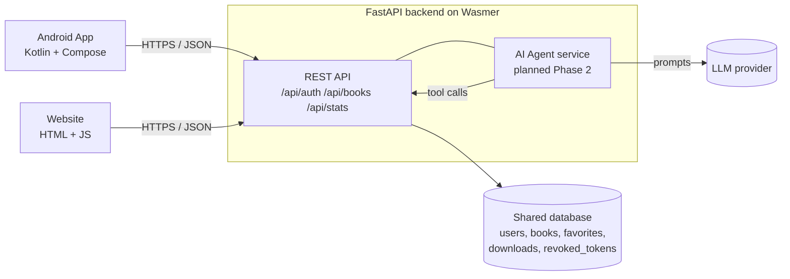

# E-Library AI - Technical Documentation (Phase 2)

University of Batangas · IPT102 Integrative Programming and Emerging Technologies 2
Individual Final Practical Examination · Version 0.2 (Phase 2, November 21, 2026)

## 1. Application overview
E-Library AI is a digital library available as an **Android app** and a **website** that share
one backend and one database. Users can browse as a **Guest** (max 5 downloads per session),
or register for an account (max 10 downloads per account). An **agentic AI assistant** embedded
in both apps will search, compare, recommend, and save books using real catalog data (Phase 2).

**Objectives**
1. Provide one shared catalog of at least 200 unique, legally downloadable books.
2. Offer secure registration, login, logout, and Guest Mode on both platforms.
3. Enforce download limits on the server, not in the client.
4. Embed (not link to) an AI agent that performs real tool-based actions.
5. Deploy the website to the cloud and ship an installable APK, with version control and CI/CD.

**Target users:** students and general readers who want free/legal books; administrators who manage the catalog.

## 2. Technology stack and justification
| Layer | Choice | Why |
|---|---|---|
| Android | Kotlin, Jetpack Compose (Material 3), Retrofit + OkHttp | Official modern Android stack; Retrofit maps the REST API to typed Kotlin calls |
| Website | HTML, CSS, vanilla JavaScript (Fetch API) | No build step, easy to explain line by line, served by the same backend |
| Backend | Python 3.12, FastAPI, Uvicorn | Automatic input validation and interactive OpenAPI docs at `/docs`; async-ready for AI calls |
| Database | SQLite (Phase 1) | Zero setup; schema is portable to PostgreSQL/MySQL, which Wasmer Edge can provision |
| Auth | JWT (PyJWT, HS256) + PBKDF2-SHA256 password hashing | Stateless tokens work identically on web and Android |
| AI (planned) | LLM with tool/function calling via the backend | Lets the model call real catalog tools; API keys stay on the server |
| Hosting | Wasmer (per exam specification) | Required host/backend platform |
| Tools | Git/GitHub, Android Studio, VS Code, pytest, GitHub Actions (Phase 3), Docker (Phase 3) | Version control, testing, DevOps |

## 3. System architecture

One backend serves both clients, so accounts, favorites and download counts stay synchronized.

## 4. Database design
Source: `backend/app/schema.sql` (SQLite now; portable to PostgreSQL).

| Table | Key columns | Purpose |
|---|---|---|
| `users` | id, full_name, email (unique), password_hash, role | Registered accounts (`user` / `admin`) |
| `books` | id, title, author, category, description, license, download_url; UNIQUE(title, author) | Shared catalog - 215 books |
| `downloads` | id, user_id **or** guest_id, book_id, created_at | Download tracking; CHECK guarantees exactly one owner |
| `favorites` | (user_id, book_id) | My Library (Final Phase) |
| `revoked_tokens` | jti, expires_at | Server-side logout |

**Catalog sources (legal only).** 211 public-domain works from Standard Ebooks (metadata read from their public GitHub repositories,
script in `backend/tools/`) plus 4 openly licensed programming books (Pro Git, Think Python, Automate the Boring Stuff, Eloquent JavaScript).
Each row stores its license and a legal download URL. Rebuild: `python tools/harvest.py && python tools/build_catalog.py`.

**Download rules (enforced in the backend).** Guest session: 5 books. Registered account: 10 books.
Re-downloading a book you already have does not use another slot. The real link is released only by `POST /api/books/{id}/download`.
Counters follow the account, so the website and the Android app always agree.

## 5. REST API (19 endpoints) - interactive docs at `/docs`
| Area | Endpoint | Access |
|---|---|---|
| System | `GET /api/health`, `GET /api/stats` | public / any session |
| Auth | `POST /api/auth/register`, `/login`, `/guest`, `/logout`; `GET /api/auth/me` | public / session |
| Catalog | `GET /api/books?q=&category=&page=&page_size=`, `GET /api/books/{id}`, `GET /api/categories` | any session |
| Downloads | `POST /api/books/{id}/download`, `GET /api/downloads` | any session (limits enforced) |
| Admin | `GET /api/admin/stats`, `/users`, `/books`; `POST /api/admin/books`; `PUT`/`DELETE /api/admin/books/{id}` | administrator only (role re-checked in DB) |

## 6. AI Assistant tab
The "AI Assistant" entry remains in the navigation of the website and the Android app, but the page is intentionally empty. The AI agent, its tools, the `/api/ai/chat` endpoint and the `ai_tool_calls` table have been removed.

## 7. Security measures implemented
* Passwords: salted PBKDF2-SHA256 (200,000 iterations); never returned by the API.
* JWT access tokens with expiry; logout revokes the token id server-side; tampered tokens rejected.
* Role-based access: admin endpoints require the `admin` role, re-checked in the database on every request.
* Parameterized SQL everywhere (injection test included); input validation on all request bodies (lengths, email, password strength, https/http-only URLs).
* Generic login error (no user enumeration); login throttling (5 failures / 5 min).
* Website renders all server data with `textContent` (no `innerHTML`) to prevent XSS.
* Download limits enforced only on the server.
* Planned: HTTPS only (remove Android cleartext flag), restrict CORS to the real origin, dependency audit and security tests in CI.

## 8. Testing
See `docs/TEST_REPORT.md`. Summary: 13 automated API tests (auth, validation, limits, admin access control, AI tools, LLM loop with mocked provider,
fallback, rate limit) and a 14-check browser end-to-end test; all pass. Android is verified manually (checklist in the report).

## 9. Known limitations and next steps
* My Library, AI "save with confirmation", Docker, CI/CD and cloud deployment are Final-Phase work.
* SQLite must live on a persistent volume when deployed (or migrate to managed PostgreSQL).
* Offline AI mode is rule-based; LLM mode needs an API key and was verified with a mocked provider (live key test is the student's step).
* Book links point to the public-domain publishers' pages; verify a sample before the final demo.
